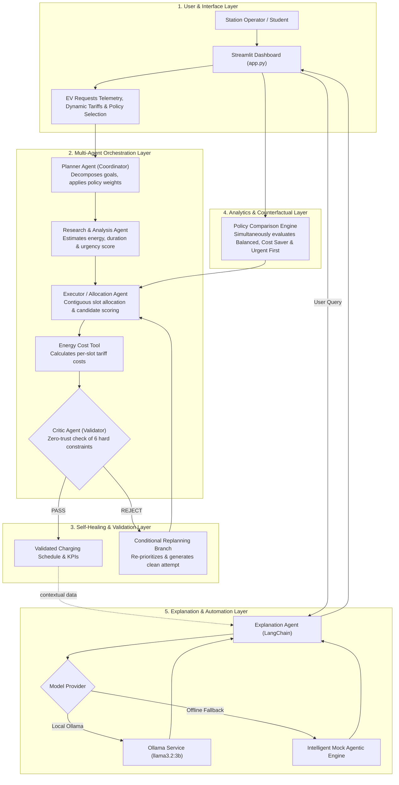

# ⚡ ChargeWise AI — Domain-Specific Agentic AI for EV Charging Management

**Course CA-3 Proof of Concept (PoC)**  
**Domain:** Smart Mobility, Clean Energy & Commercial Fleet Operations (Business Operations)  
**Deliverables Included:** Working Streamlit UI PoC, Architecture Diagram (`architecture.mmd`), Presentation Deck (`ChargeWiseAI_CA3_Presentation.pptx`), 5-Minute Presentation Script (`PRESENTATION.md`), and Unit Tests (`tests/test_agents.py`).

---

## 🎯 1. Problem Statement & Domain Justification

### The Real-World Domain
Commercial electric vehicle (EV) hubs (e.g. taxi fleets, last-mile delivery depots, and public transit terminals) are electrifying rapidly. These stations operate under:
- **Strict transformer capacity limits** (cannot charge all vehicles at maximum power simultaneously without tripping substation breakers).
- **Time-of-Use (ToU) electricity tariffs** where electricity prices surge during peak demand hours (e.g. ₹11.00/kWh) and drop during off-peak slots (e.g. ₹6.80/kWh).
- **Varying operational deadlines:** Delivery vans and emergency vehicles have tight departure deadlines, whereas commuter vehicles have hours of slack time.

### Existing Business Inefficiency
Traditionally, charging stations rely on uncoordinated **First-Come-First-Serve (FCFS)** queuing:
1. **Peak Demand Penalties:** Vehicles plug in and charge immediately upon arrival, frequently drawing full power during peak tariff windows, inflating power bills by 25–40%.
2. **Contention & Stranded Vehicles:** Non-urgent vehicles with 70% battery hog fast chargers, leaving low-battery urgent vehicles stranded or undercharged at departure.
3. **Zero Self-Healing / Fault Tolerance:** If a charger trips or an allocation conflict arises, legacy rule systems halt or require manual operator reassignment.

### Proposed Agentic AI Solution
ChargeWise AI deploys an **Agentic Multi-Agent Architecture** that autonomously:
- Ingests incoming EV telemetry (arrival, departure, battery %, target %, charger kW).
- Ranks vehicles using a multi-factor **Urgency Score Heuristic**.
- Allocates contiguous time slots across chargers to perform **Dynamic Tariff Arbitrage** (shifting flexible loads to cheap off-peak hours).
- Enforces an independent **Critic Agent** that audits 6 physical constraints (zero-trust safety boundary).
- Self-heals via **Autonomous Replanning** if conflicts or capacity violations are detected.
- Interprets dispatch decisions in plain English via a **Local AI Explanation Agent** (LangChain + Ollama or offline Mock Engine).

---

## 🤖 2. Agent Roles & Architecture (CA-3 Taxonomy Mapping)

| Agent Name | CA-3 Category | Responsibilities | Tools / Techniques |
|---|---|---|---|
| **Planner Agent (Coordinator)** | *Planner Agent* | Decomposes high-level charging objectives into subtasks, applies policy weights (`Balanced`, `Cost saver`, `Urgent first`), and manages conditional replan loops. | Task decomposition, execution pipeline, error routing |
| **Research & Analysis Agent** | *Research Agent* | Ingests EV telemetry and time-of-use tariffs. Computes required kWh, duration in 30-min slots, and multi-factor Urgency Score. | Feature calculation, deadline slack evaluation |
| **Executor Agent (Charging Planner)** | *Executor Agent* | Evaluates candidate charger-slot assignments using policy heuristics; assigns contiguous slots across 4 physical chargers. | Priority queues, multi-objective candidate scoring |
| **Energy Cost Tool / Agent** | *Executor / Tools* | Calculates per-slot energy deliveries and applies time-of-use tariffs to calculate total station electricity costs. | Deterministic tariff arithmetic |
| **Critic Agent (Validator)** | *Critic Agent* | Zero-trust independent safety layer. Evaluates 6 hard constraints. Rejects invalid plans with diagnostic logs and triggers replanning. | Deterministic constraint checking |
| **Explanation Agent** | *Business Automation Agent* | Interprets schedules for human station operators, explains policy trade-offs, and answers operational questions. | LangChain + Local Ollama (`llama3.2:3b`) / Offline Mock Engine |

---

## 📐 3. System Architecture & Workflow



---

## 🧪 4. Output Validation & Self-Healing (The Critic Agent)

The **Critic Agent** is strictly decoupled from the Planner to maintain a rigorous mathematical safety boundary. It verifies:
1. **No Charger Overlap:** Exactly one EV per charger in any 30-minute slot.
2. **No Vehicle Double-Booking:** An EV cannot charge at two stations simultaneously.
3. **Arrival Boundaries:** No slots scheduled prior to vehicle arrival.
4. **Departure Deadlines:** No slots scheduled at or after departure.
5. **Power Limits:** Assigned power does not exceed vehicle max intake kW.
6. **Horizon Bounds:** All slots fall within the active scheduling horizon.

### Self-Healing Demonstration Button (`🧪 Demo Rejection + Replan`)
Clicking this button intentionally injects a synthetic charger collision into Attempt 1.
- The **Critic Agent catches the violation**, logs a diagnostic error, and issues a `REJECT` verdict.
- The **Coordinator catches the rejection** and autonomously initiates **Attempt 2**, rebuilding a validated conflict-free schedule.
- Proves closed-loop agentic behavior beyond a standard script.

---

## 💡 5. Zero-Cost Local AI & Offline Mock Engine

- **Option A: Free Local Ollama (LangChain)**
  - Runs locally with zero paid API keys or subscriptions.
  - Recommended model: `llama3.2:3b`.
- **Option B: Built-in Mock Agentic Engine (Instant & 100% Offline)**
  - If Ollama is not installed or offline, the app seamlessly uses an internal rule-grounded Mock AI agent.
  - Zero crashes, zero external dependencies, 100% reliability during college evaluation or viva!

---

## 🚀 6. Quick Start Guide (Windows / PowerShell)

### Step 1: Install Dependencies
```powershell
python -m pip install -r requirements.txt
```

### Step 2: (Optional) Set up Ollama for Local LLM
If you want to use the live local LLM:
1. Download Ollama from https://ollama.com/download/windows
2. In terminal run:
   ```powershell
   ollama pull llama3.2:3b
   ```
*(Note: If you skip Ollama, the built-in Mock AI Agent handles all explanations instantly!)*

### Step 3: Run the Streamlit Application
```powershell
python -m streamlit run app.py
```
Open your browser at `http://localhost:8501`.

### Step 4: Run Automated Unit Tests
```powershell
python -m unittest discover -s tests -v
```

---

## 📽️ 7. Presentation & 5-Minute Defense Material

- **PowerPoint Slide Deck:** `ChargeWiseAI_CA3_Presentation.pptx` (9 widescreen 16:9 slides covering Problem, Architecture, PoC, Validation, Results, and Viva Defense).
- **Regenerate PPT:** Run `python generate_ppt.py`.
- **5-Minute Speaking Script & Viva Q&A:** See `PRESENTATION.md` for a minute-by-minute speaking script and answers to tough technical questions.

---

## 📋 8. Assumptions, Limitations & Future Scope

### Current PoC Assumptions
1. Standardized 60 kWh battery pack capacity.
2. Constant charging power (linear rate; does not model non-linear lithium-ion CC-CV taper).
3. Discrete 30-minute block granularity.
4. Synthetic reproducible pricing tables and EV telemetry.

### Future Scope & Production Roadmap
- **OCPP 2.0.1 Protocol:** Direct hardware integration with physical smart chargers.
- **Vehicle-to-Grid (V2G):** Discharging energy back to the grid during extreme price spikes.
- **Model Context Protocol (MCP):** Real-time grid API tools for live dynamic transformer monitoring.
